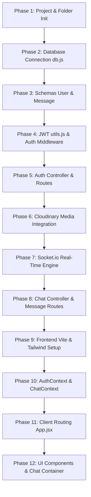
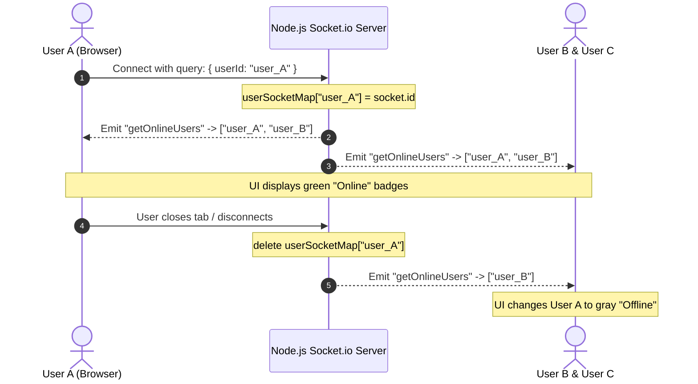

# 📘 QuickChat Full-Stack Project — Complete Phase-Wise Guide & Technical Notes

> **Welcome to the comprehensive technical documentation for QuickChat!**  
> This guide is crafted specifically for beginners who have a basic understanding of programming and want to understand **every single decision, terminal command, package, schema, route, API key, real-time mechanism, and interview concept** in this project from scratch.

---

## 📑 Table of Contents

1. [High-Level Project Overview & Architecture](#1-high-level-project-overview--architecture)
2. [Package Installation Commands & Ecosystem Analysis](#2-package-installation-commands--ecosystem-analysis)
   - [Backend Packages & Installation Commands](#backend-packages--installation-commands)
   - [Frontend Packages & Installation Commands](#frontend-packages--installation-commands)
   - [Why Each Package Was Installed, Alternatives & Industry Recommendations](#why-each-package-was-installed-alternatives--industry-recommendations)
3. [Complete API Key & Environment Configuration Guide](#3-complete-api-key--environment-configuration-guide)
   - [What is an API Key & Environment Variable?](#what-is-an-api-key--environment-variable)
   - [1. MongoDB Atlas Connection URI (`MONGODB_URI`)](#1-mongodb-atlas-connection-uri-mongodb_uri)
   - [2. JSON Web Token Secret (`JWT_SECRET`)](#2-json-web-token-secret-jwt_secret)
   - [3. Cloudinary Media Credentials (`CLOUDINARY_*`)](#3-cloudinary-media-credentials-cloudinary_)
   - [4. Frontend Origin & CORS (`CLIENT_URL`) & Server Port (`PORT`)](#4-frontend-origin--cors-client_url--server-port-port)
   - [5. Vite Frontend Backend URL (`VITE_BACKEND_URL`)](#5-vite-frontend-backend-url-vite_backend_url)
   - [Security Rules for API Keys & `.env`](#security-rules-for-api-keys--env)
4. [Phase-by-Phase Development Roadmap (Step-by-Step Evolution)](#4-phase-by-phase-development-roadmap-step-by-step-evolution)
   - [Phase 1: Project Initialization & Directory Structuring](#phase-1-project-initialization--directory-structuring)
   - [Phase 2: Database Configuration & Connection Utility](#phase-2-database-configuration--connection-utility)
   - [Phase 3: Database Modeling & Schema Design](#phase-3-database-modeling--schema-design)
   - [Phase 4: Security Utilities & Authentication Middleware](#phase-4-security-utilities--authentication-middleware)
   - [Phase 5: User & Authentication Controller and Routes](#phase-5-user--authentication-controller-and-routes)
   - [Phase 6: Cloudinary Media Storage Integration](#phase-6-cloudinary-media-storage-integration)
   - [Phase 7: Real-Time Engine Setup (Socket.io + HTTP Server)](#phase-7-real-time-engine-setup-socketio--http-server)
   - [Phase 8: Chat Controller & Messaging Routes](#phase-8-chat-controller--messaging-routes)
   - [Phase 9: Frontend Initialization & Styling System (Tailwind v4)](#phase-9-frontend-initialization--styling-system-tailwind-v4)
   - [Phase 10: Global State Management (AuthContext & ChatContext)](#phase-10-global-state-management-authcontext--chatcontext)
   - [Phase 11: Single Page Application Routing & Navigation Guards](#phase-11-single-page-application-routing--navigation-guards)
   - [Phase 12: User Interface Components & Media Optimization](#phase-12-user-interface-components--media-optimization)
5. [Complete REST API Directory (9 Endpoints)](#5-complete-rest-api-directory-9-endpoints)
6. [Real-Time Socket.io Mechanics & Presence Tracking](#6-real-time-socketio-mechanics--presence-tracking)
7. [Master Interview Questions & Deep-Dive Answers](#7-master-interview-questions--deep-dive-answers)
   - [Q1: What is a Schema in MongoDB/Mongoose?](#q1-what-is-a-schema-in-mongodbmongoose)
   - [Q2: In the User schema, is the name unique or not? Why? What about email?](#q2-in-the-user-schema-is-the-name-unique-or-not-why-what-about-email)
   - [Q3: How do we know whether a user is online or offline in real-time?](#q3-how-do-we-know-whether-a-user-is-online-or-offline-in-real-time)
   - [Q4: How does 1-on-1 private messaging work under the hood?](#q4-how-does-1-on-1-private-messaging-work-under-the-hood)
   - [Q5: What is the difference between WebSockets and HTTP Polling?](#q5-what-is-the-difference-between-websockets-and-http-polling)
   - [Q6: How does the complete login/logout cycle work?](#q6-how-does-the-complete-loginlogout-cycle-work)
   - [Q7: Why do we hash passwords with bcrypt instead of encrypting them?](#q7-why-do-we-hash-passwords-with-bcrypt-instead-of-encrypting-them)
   - [Q8: Why store media on Cloudinary instead of directly in MongoDB?](#q8-why-store-media-on-cloudinary-instead-of-directly-in-mongodb)
   - [Q9: Why use React Context API instead of Redux or Zustand?](#q9-why-use-react-context-api-instead-of-redux-or-zustand)
   - [Q10: What is CORS and why did it cause problems?](#q10-what-is-cors-and-why-did-it-cause-problems)
   - [Q11: How does unread message tracking work?](#q11-how-does-unread-message-tracking-work)
   - [Q12: Why do we compress images on the client before sending them to the server?](#q12-why-do-we-compress-images-on-the-client-before-sending-them-to-the-server)
8. [Summary Cheatsheet for Beginners](#8-summary-cheatsheet-for-beginners)

---

## 1. High-Level Project Overview & Architecture

### What is QuickChat?
**QuickChat** is a production-ready, full-stack, real-time messaging application. It allows registered users to:
1. Create an account, log in securely, and personalize their profile (avatar, name, bio).
2. Browse a contact sidebar displaying all registered users with their live **Online/Offline** status indicator and dynamic **unread message count badges**.
3. Send and receive instant text messages and images with sub-second latency.
4. Browse an interactive shared media gallery displaying all photos exchanged in a chat.

### What is the MERN Stack?
- **M — MongoDB**: A NoSQL document database used to store users and message history.
- **E — Express.js**: A minimalist web server framework for Node.js to build REST APIs.
- **R — React.js (v19)**: A component-based frontend library for an interactive Single Page Application (SPA).
- **N — Node.js**: The JavaScript runtime environment executing backend code outside the browser.

### Architectural Diagram
```
 ┌─────────────────────────────────────────────────────────────┐
 │                    React Frontend (Client)                  │
 │  - React Router (Navigation: /login, /, /profile)           │
 │  - AuthContext (JWT session, Axios config, Socket manager)  │
 │  - ChatContext (User list, active chat, message listener)   │
 └──────────────┬───────────────────────────────▲──────────────┘
                │ HTTP REST                     │ WebSocket (ws://)
                │ (Headers: token)              │ (Query: userId)
                ▼                               ▼
 ┌─────────────────────────────────────────────────────────────┐
 │                   Express + Node.js Server                  │
 │  - Middleware: CORS, express.json(4mb), protectRoute        │
 │  - REST Routes: /api/auth/* & /api/messages/*               │
 │  - Socket.io Server: userSocketMap { userId: socketId }     │
 └──────────────┬───────────────────────────────┬──────────────┘
                ▼                               ▼
      ┌──────────────────┐            ┌──────────────────┐
      │  MongoDB Atlas   │            │ Cloudinary CDN   │
      │  (Users/Messages)│            │ (Avatars/Images) │
      └──────────────────┘            └──────────────────┘
```

---

## 2. Package Installation Commands & Ecosystem Analysis

### Backend Packages & Installation Commands

To set up the backend server from scratch, you open your terminal, navigate to the `server/` directory, initialize the Node project, and install the dependencies:

```bash
# 1. Navigate into the server directory
cd server

# 2. Initialize a new Node.js package.json file with default values
npm init -y

# 3. Configure ES Modules by adding "type": "module" in package.json
npm pkg set type="module"

# 4. Install production dependencies
npm install express mongoose bcryptjs jsonwebtoken socket.io cloudinary cors dotenv

# 5. Install development dependency for live auto-reloading
npm install -D nodemon
```

> **Beginner Note on Flags:**
> - `npm init -y`: The `-y` flag stands for "yes to all prompts", generating `package.json` immediately.
> - `npm install`: Adds packages to `dependencies` (required both in development and production).
> - `npm install -D`: The `-D` flag (short for `--save-dev`) adds packages to `devDependencies` (tools used only while developing on your computer, like `nodemon`).

---

### Frontend Packages & Installation Commands

To set up the React client from scratch, you navigate to the root directory, scaffold a new Vite project, and install all required frontend libraries:

```bash
# 1. Create a new Vite project using the React template
npm create vite@latest client -- --template react

# 2. Navigate into the newly created client directory
cd client

# 3. Install core dependencies
npm install

# 4. Install HTTP client, WebSocket client, routing, and UI toast alert packages
npm install axios socket.io-client react-router-dom react-hot-toast

# 5. Install modern Tailwind CSS v4 and the official Vite integration plugin
npm install tailwindcss @tailwindcss/vite
```

---

### Why Each Package Was Installed, Alternatives & Industry Recommendations

#### Backend Packages Breakdown

| Package | Exact Terminal Install Command | Why It Was Installed | Alternative Options | Evaluation & Recommendation |
| :--- | :--- | :--- | :--- | :--- |
| **`express`** (^5.1.0) | `npm install express` | Minimalist web framework for Node.js. Handles HTTP requests, URL routing, middleware, and JSON responses. | **Fastify**, **NestJS**, **Koa.js** | **Express** is the most widely documented, battle-tested framework. Fastify is faster for high throughput; NestJS is great for large corporate codebases; but Express is the ultimate standard for full-stack MERN apps. |
| **`mongoose`** (^8.14.1) | `npm install mongoose` | Object Data Modeling (ODM) library for MongoDB. Enforces structured schemas, data validation, and model queries. | **Prisma**, **TypeORM**, **Native MongoDB Driver** | MongoDB is schemaless by default. Mongoose enforces strict types (strings, booleans, dates) and handles relations between Users and Messages cleanly via `ref`. |
| **`socket.io`** (^4.8.1) | `npm install socket.io` | Bidirectional, low-latency WebSocket communication engine for instant messaging and online presence tracking. | **Native `ws`**, **Pusher**, **Firebase Realtime DB**, **Ably** | Pure WebSockets (`ws`) lack rooms and automatic reconnection out of the box. Socket.io manages connection fallbacks and custom events effortlessly. |
| **`bcryptjs`** (^3.0.2) | `npm install bcryptjs` | Cryptographic password hashing library using salt rounds. Ensures passwords are never stored in plain text. | **`argon2`**, **`bcrypt` (native C++)**, **`scrypt`** | Native `bcrypt` requires C++ compilers on your machine which often fails on Windows or cloud serverless environments. `bcryptjs` is 100% pure JavaScript and works everywhere without build errors. |
| **`jsonwebtoken`** (^9.0.2) | `npm install jsonwebtoken` | Creates and verifies JSON Web Tokens (JWT) for stateless authentication transmitted in HTTP request headers. | **Session Cookies (`express-session`)**, **OAuth / Auth0**, **Passport.js** | JWT is stateless: the server doesn't need a session database. Each request carries the signed token, allowing effortless horizontal scaling. |
| **`cloudinary`** (^2.6.0) | `npm install cloudinary` | Cloud media management SDK to upload, optimize, and serve user profile pictures and chat photos via global CDN. | **AWS S3**, **Firebase Storage**, **Google Cloud Storage** | Storing images directly inside MongoDB causes performance degradation. Cloudinary provides free cloud hosting, CDN distribution, and image transformations. |
| **`cors`** (^2.8.5) | `npm install cors` | Express middleware to enable Cross-Origin Resource Sharing so browser requests from Vite (port 5173) can reach Node (port 5000). | **Manual headers (`res.setHeader`)** | The `cors` package provides clean origin whitelisting, credentials support, and HTTP method controls without writing repetitive header code. |
| **`dotenv`** (^16.5.0) | `npm install dotenv` | Loads environment variables from a private `.env` file into Node.js `process.env`. | **Built-in Node 20 (`--env-file`)**, **cross-env** | Keeps database passwords, secret keys, and Cloudinary credentials out of source code so they are never accidentally pushed to GitHub. |
| **`nodemon`** (^3.1.10) | `npm install -D nodemon` | Development tool that monitors server files and automatically restarts Node whenever you save code edits. | **`node --watch`**, **`tsx`**, **`pm2`** | Saves developer time by eliminating manual server restarts after every code modification. |

---

#### Frontend Packages Breakdown

| Package | Exact Terminal Install Command | Why It Was Installed | Alternative Options | Evaluation & Recommendation |
| :--- | :--- | :--- | :--- | :--- |
| **`react`** & **`react-dom`** (^19.0.0) | `npm install react react-dom` | Core UI library for declarative component creation, virtual DOM rendering, and reactive state management. | **Vue.js**, **Svelte**, **Angular** | React has the largest ecosystem and developer community. React 19 provides modern hooks and rendering optimizations. |
| **`vite`** (^6.3.1) | `npm create vite@latest` | Next-generation frontend bundler and local development server using native ES Modules. | **Webpack**, **Create React App (CRA)**, **Turbopack** | CRA is deprecated and slow. Vite starts the dev server in milliseconds and provides instant Hot Module Replacement (HMR). |
| **`tailwindcss`** & **`@tailwindcss/vite`** (^4.1.4) | `npm install tailwindcss @tailwindcss/vite` | Modern utility-first CSS framework for crafting responsive, glassmorphic UI designs directly inside JSX classes. | **Bootstrap**, **Material UI**, **Chakra UI**, **CSS Modules** | Tailwind CSS v4 is ultra-fast, has zero build overhead with its native Vite plugin, and avoids writing custom CSS files for every component. |
| **`react-router-dom`** (^7.5.3) | `npm install react-router-dom` | Client-side routing library for Single Page Applications (SPAs). Changes views (`/`, `/login`, `/profile`) without page reloads. | **TanStack Router**, **Wouter**, **Native `window.location`** | The industry standard for React navigation, providing route protection and redirects (`<Navigate to="/login" />`). |
| **`axios`** (^1.9.0) | `npm install axios` | Promise-based HTTP client for browser requests. Simplifies setting base URLs, default headers, and JSON parsing. | **Native `fetch()` API**, **Ky** | While native `fetch` exists, Axios automatically parses JSON and allows global header configuration (`axios.defaults.headers.common["token"] = token`). |
| **`socket.io-client`** (^4.8.1) | `npm install socket.io-client` | WebSocket client to connect to the backend Socket.io server, listen for `newMessage` events, and receive online users. | **Native WebSocket API** | Pairs seamlessly with the backend Socket.io server, featuring automatic reconnection and heartbeat status pings. |
| **`react-hot-toast`** (^2.5.2) | `npm install react-hot-toast` | UI notification alert library for displaying non-intrusive popup badges (e.g. "Login successful", "Profile updated"). | **`sonner`**, **`react-toastify`** | Lightweight, elegant, highly customizable, and works with a simple one-line function call `toast.success()`. |

---

## 3. Complete API Key & Environment Configuration Guide

### What is an API Key & Environment Variable?
- An **Environment Variable** is a dynamic value that your computer or cloud server stores outside of your source code.
- An **API Key** is a unique secret string used by an external service (like MongoDB or Cloudinary) to verify your identity and grant access to your database or storage account.
- **Why hide them?** If you commit your database password or Cloudinary secret to a public GitHub repository, automated bots will steal your credentials within minutes, potentially destroying your data or incurring bills.

---

### 1. MongoDB Atlas Connection URI (`MONGODB_URI`)

#### What It Is:
The database connection string that allows Mongoose to connect to your cloud MongoDB Atlas database.  
Example format:
```env
MONGODB_URI=mongodb+srv://<username>:<password>@cluster0.mongodb.net/quickchat?retryWrites=true&w=majority
```

#### Step-by-Step Instructions to Obtain It:
1. Go to [mongodb.com/cloud/atlas](https://www.mongodb.com/cloud/atlas) and create a free account.
2. Click **"Build a Database"** and select the **FREE (M0)** shared tier. Choose any nearby cloud region (e.g., AWS / Mumbai or us-east-1).
3. **Set up Database Access (Credentials)**:
   - Go to **Security** -> **Database Access** -> Click **"Add New Database User"**.
   - Set **Authentication Method** to **Password**.
   - Enter a username (e.g., `admin`) and a secure password (e.g., `MyChatSecret123`).
   - Assign the role: **"Read and write to any database"**.
4. **Set up Network Access (IP Whitelist)**:
   - Go to **Security** -> **Network Access** -> Click **"Add IP Address"**.
   - Click **"Allow Access from Anywhere"** (`0.0.0.0/0`). This allows both your local computer and your deployed cloud server to connect.
5. **Copy Connection String**:
   - Go to **Deployment** -> **Database** -> Click the **"Connect"** button on your cluster.
   - Choose **"Drivers"** (Node.js).
   - Copy the URI provided. Replace `<password>` with the user password you created in Step 3.

---

### 2. JSON Web Token Secret (`JWT_SECRET`)

#### What It Is:
A private cryptographic key used by `jsonwebtoken` to digitally sign authentication tokens. When the client sends the token back, the server verifies it against this secret. If anyone tampers with the token, verification fails.

#### How to Generate a Strong Secret:
You can generate a cryptographically secure 256-bit random string directly in your terminal using Node.js:
```bash
node -e "console.log(require('crypto').randomBytes(32).toString('hex'))"
```
Output example:
```env
JWT_SECRET=4f8b9e6a3d2c1b5e7f0a9b8c7d6e5f4a3b2c1d0e9f8a7b6c5d4e3f2a1b0c9d8e
```

---

### 3. Cloudinary Media Credentials (`CLOUDINARY_*`)

#### What They Are:
Credentials required by the Cloudinary Node.js SDK to authenticate requests when uploading user profile pictures and chat photos.

```env
CLOUDINARY_CLOUD_NAME=your_cloud_name
CLOUDINARY_API_KEY=your_api_key
CLOUDINARY_API_SECRET=your_api_secret
```

#### Step-by-Step Instructions to Obtain Them:
1. Go to [cloudinary.com](https://cloudinary.com/) and register for a free account.
2. Once logged in, navigate to the **Dashboard** / **Console Home**.
3. In the **Product Environment Credentials** card on the dashboard, you will find:
   - **Cloud Name** (e.g., `dxyabc123`)
   - **API Key** (e.g., `123456789012345`)
   - **API Secret** (Click "View API Secret" or copy the hidden string)
4. Copy these values into your `server/.env` file.

---

### 4. Frontend Origin & CORS (`CLIENT_URL`) & Server Port (`PORT`)

```env
PORT=5000
CLIENT_URL=http://localhost:5173,https://your-frontend.vercel.app
```
- **`PORT`**: Defines which local TCP port the Express server listens on (default is 5000).
- **`CLIENT_URL`**: Specifies which frontend domains are allowed to communicate with this backend API. Separate multiple origins with commas.

---

### 5. Vite Frontend Backend URL (`VITE_BACKEND_URL`)

Located in `client/.env`:
```env
VITE_BACKEND_URL=http://localhost:5000
```
> **Important Vite Security Rule:** In Vite, only environment variables prefixed with `VITE_` are exposed to your browser code. Any variable without `VITE_` is hidden by Vite to prevent accidental data leaks.

---

### Security Rules for API Keys & `.env`
1. **Never commit `.env` to Git**: Always ensure `.env` is listed inside `.gitignore`.
2. **Commit `.env.example` instead**: Commit a template file showing the required variable names without the actual secret values.
3. **Rotate keys if exposed**: If you ever accidentally commit an API key to GitHub, invalidate it immediately in the respective dashboard (MongoDB or Cloudinary) and generate a new one.

---

## 4. Phase-by-Phase Development Roadmap (Step-by-Step Evolution)

Here is the exact progression showing how each phase builds directly upon the previous one.



---

### Phase 1: Project Initialization & Directory Structuring

#### What We Built:
We created the root workspace and split it cleanly into two separate environments: `server/` and `client/`.

#### Files Created:
- `.gitignore`: Configured to ignore `node_modules/`, `.env`, and `dist/`.
- `server/package.json`: Configured with `"type": "module"` to enable ES Modules (`import/export` instead of legacy `require`).
- `server/.env`: Created to store local secrets.

#### How It Connects to Next Phase:
With Node initialized and packages installed, the server needs a persistent database to store data. This leads to Phase 2.

---

### Phase 2: Database Configuration & Connection Utility

#### What We Built:
We created the database connection helper in [db.js](file:///c:/Users/hp/Downloads/dMZoQjZk8uvsxbeps8yoVb/QuickChat-Full-Stack/server/lib/db.js).

#### Code Highlights:
```javascript
// server/lib/db.js
import mongoose from "mongoose";

export const connectDB = async () => {
    try {
        if (mongoose.connection.readyState >= 1) return; // Prevent duplicate connections
        await mongoose.connect(process.env.MONGODB_URI);
        console.log("Database Connected");
    } catch (error) {
        console.log("MongoDB Connection Error:", error);
    }
};
```

#### Why We Built This:
Before processing any user signup or login, Mongoose must establish a stable connection with MongoDB Atlas. Reusing `mongoose.connection.readyState` prevents opening multiple connection pools during server reloads.

#### How It Connects to Next Phase:
Now that the database connects, we must define the structure of the data we will store in it. This leads to Phase 3.

---

### Phase 3: Database Modeling & Schema Design

#### What We Built:
We created two Mongoose models:
1. [User.js](file:///c:/Users/hp/Downloads/dMZoQjZk8uvsxbeps8yoVb/QuickChat-Full-Stack/server/models/User.js): Blueprint for user accounts.
2. [Message.js](file:///c:/Users/hp/Downloads/dMZoQjZk8uvsxbeps8yoVb/QuickChat-Full-Stack/server/models/Message.js): Blueprint for chat messages.

#### Details of Schemas:
- **`userSchema`**:
  - `email`: `String`, `required: true`, **`unique: true`** (No duplicate registrations).
  - `fullName`: `String`, `required: true` (Can be shared by multiple people; **NOT unique**).
  - `password`: `String`, `required: true`, `minlength: 6` (Stores hashed password).
  - `profilePic`: `String`, `default: ""` (Stores Cloudinary URL).
  - `bio`: `String` (User status text).
  - `{ timestamps: true }`: Generates `createdAt` and `updatedAt`.
- **`messageSchema`**:
  - `senderId`: `mongoose.Schema.Types.ObjectId`, `ref: "User"`, `required: true`.
  - `receiverId`: `mongoose.Schema.Types.ObjectId`, `ref: "User"`, `required: true`.
  - `text`: `String` (Optional if sending image).
  - `image`: `String` (Optional Cloudinary image URL).
  - `seen`: `Boolean`, `default: false` (Tracks read receipts).

#### How It Connects to Next Phase:
Now that the data structure is ready, we need utilities to sign tokens and protect API routes from unauthorized access. This leads to Phase 4.

---

### Phase 4: Security Utilities & Authentication Middleware

#### What We Built:
1. [utils.js](file:///c:/Users/hp/Downloads/dMZoQjZk8uvsxbeps8yoVb/QuickChat-Full-Stack/server/lib/utils.js): Token generator function using `jsonwebtoken`.
2. [auth.js](file:///c:/Users/hp/Downloads/dMZoQjZk8uvsxbeps8yoVb/QuickChat-Full-Stack/server/middleware/auth.js): `protectRoute` middleware.

#### Code Highlights:
```javascript
// server/lib/utils.js
export const generateToken = (userId) => {
    return jwt.sign({ userId }, process.env.JWT_SECRET);
};
```
```javascript
// server/middleware/auth.js
export const protectRoute = async (req, res, next) => {
    try {
        const token = req.headers.token;
        const decoded = jwt.verify(token, process.env.JWT_SECRET);
        const user = await User.findById(decoded.userId).select("-password");
        if (!user) return res.json({ success: false, message: "User not found" });

        req.user = user; // Attach user to request
        next();
    } catch (error) {
        res.json({ success: false, message: error.message });
    }
};
```

#### How It Connects to Next Phase:
With token creation and verification ready, we can now build the controllers and routes for user registration, login, profile updates, and auth checking. This leads to Phase 5.

---

### Phase 5: User & Authentication Controller and Routes

#### What We Built:
1. [userController.js](file:///c:/Users/hp/Downloads/dMZoQjZk8uvsxbeps8yoVb/QuickChat-Full-Stack/server/controllers/userController.js):
   - `signup`: Validates input, verifies email is not taken, hashes password with `bcrypt.hash`, creates user, returns token.
   - `login`: Finds user by email, checks password with `bcrypt.compare`, returns token.
   - `checkAuth`: Returns `req.user` if JWT is valid.
   - `updateProfile`: Updates profile bio, name, or profile picture.
2. [userRoutes.js](file:///c:/Users/hp/Downloads/dMZoQjZk8uvsxbeps8yoVb/QuickChat-Full-Stack/server/routes/userRoutes.js):
   - `POST /api/auth/signup`
   - `POST /api/auth/login`
   - `PUT  /api/auth/update-profile` (Protected)
   - `GET  /api/auth/check` (Protected)

#### How It Connects to Next Phase:
To allow users to upload avatar images and send photos in chat, we need a media storage provider. This leads to Phase 6.

---

### Phase 6: Cloudinary Media Storage Integration

#### What We Built:
We created [cloudinary.js](file:///c:/Users/hp/Downloads/dMZoQjZk8uvsxbeps8yoVb/QuickChat-Full-Stack/server/lib/cloudinary.js) to configure the Cloudinary v2 SDK with credentials from `process.env`.

#### Code Highlights:
```javascript
// server/lib/cloudinary.js
import { v2 as cloudinary } from "cloudinary";
import "dotenv/config";

cloudinary.config({
    cloud_name: process.env.CLOUDINARY_CLOUD_NAME,
    api_key: process.env.CLOUDINARY_API_KEY,
    api_secret: process.env.CLOUDINARY_API_SECRET,
});

export default cloudinary;
```

#### Why We Built This:
When a user updates their avatar or attaches an image in chat, the file is sent as a Base64 string. The server calls `cloudinary.uploader.upload(base64)` and saves only the returned HTTPS URL in MongoDB.

#### How It Connects to Next Phase:
Now that user authentication and media hosting work, we need real-time bi-directional messaging so users don't have to refresh the browser to see new messages. This leads to Phase 7.

---

### Phase 7: Real-Time Engine Setup (Socket.io + HTTP Server)

#### What We Built:
In [server.js](file:///c:/Users/hp/Downloads/dMZoQjZk8uvsxbeps8yoVb/QuickChat-Full-Stack/server/server.js), we integrated the native Node `http` server with both Express and Socket.io.

#### Code Highlights:
```javascript
// server/server.js
const app = express();
const server = http.createServer(app);

export const io = new Server(server, {
    cors: { origin: "*", credentials: true }
});

export const userSocketMap = {}; // Maps { userId: socketId }

io.on("connection", (socket) => {
    const userId = socket.handshake.query.userId;
    if (userId) userSocketMap[userId] = socket.id;

    // Broadcast updated online list
    io.emit("getOnlineUsers", Object.keys(userSocketMap));

    socket.on("disconnect", () => {
        delete userSocketMap[userId];
        io.emit("getOnlineUsers", Object.keys(userSocketMap));
    });
});
```

#### How It Connects to Next Phase:
With Socket.io running, we can now implement message sending, conversation retrieval, unread message counts, and real-time message broadcasting. This leads to Phase 8.

---

### Phase 8: Chat Controller & Messaging Routes

#### What We Built:
1. [messageController.js](file:///c:/Users/hp/Downloads/dMZoQjZk8uvsxbeps8yoVb/QuickChat-Full-Stack/server/controllers/messageController.js):
   - `getUsersForSidebar`: Finds all registered users except logged-in user; calculates unseen message count per contact.
   - `getMessages`: Retrieves conversation history between logged-in user and selected contact; marks received messages as `seen: true`.
   - `sendMessage`: Saves message to MongoDB; looks up recipient in `userSocketMap`; emits real-time `newMessage` event if recipient is online.
   - `markMessageAsSeen`: Updates a message's `seen` status to `true`.
2. [messageRoutes.js](file:///c:/Users/hp/Downloads/dMZoQjZk8uvsxbeps8yoVb/QuickChat-Full-Stack/server/routes/messageRoutes.js):
   - `GET  /api/messages/users` (Protected)
   - `GET  /api/messages/:id` (Protected)
   - `PUT  /api/messages/mark/:id` (Protected)
   - `POST /api/messages/send/:id` (Protected)

#### How It Connects to Next Phase:
The entire backend API and real-time server are now complete. Now we transition to the frontend to build the user interface. This leads to Phase 9.

---

### Phase 9: Frontend Initialization & Styling System (Tailwind v4)

#### What We Built:
1. Scaffolded Vite React client using `npm create vite@latest`.
2. Configured Tailwind CSS v4 in `client/vite.config.js` with `@tailwindcss/vite`.
3. Added base styles and Google Fonts (`Outfit`) in `client/src/index.css`.

#### Why We Built This:
Tailwind v4 delivers zero-runtime, lightning-fast utility styling for glassmorphism (`backdrop-blur-xl`, semi-transparent backgrounds, custom gradients).

#### How It Connects to Next Phase:
Before building visual components, we must build the state management layer to handle authentication, tokens, and live socket events. This leads to Phase 10.

---

### Phase 10: Global State Management (AuthContext & ChatContext)

#### What We Built:
1. [AuthContext.jsx](file:///c:/Users/hp/Downloads/dMZoQjZk8uvsxbeps8yoVb/QuickChat-Full-Stack/client/context/AuthContext.jsx):
   - Manages `authUser`, `token` persistence in `localStorage`, and `axios.defaults.headers.common["token"]`.
   - Initializes Socket.io client connection on login and manages the `onlineUsers` state array.
   - Disconnects socket and clears storage on `logout()`.
2. [ChatContext.jsx](file:///c:/Users/hp/Downloads/dMZoQjZk8uvsxbeps8yoVb/QuickChat-Full-Stack/client/context/ChatContext.jsx):
   - Manages `users` (sidebar contacts), `selectedUser` (active chat), `messages` (conversation history), and `unseenMessages` (unread badges).
   - Listens to the `newMessage` socket event: appends to active chat if sender is selected, or increments unread badge if sender is in the background.

#### How It Connects to Next Phase:
With global states accessible everywhere, we can construct the application's page routes and protect private views. This leads to Phase 11.

---

### Phase 11: Single Page Application Routing & Navigation Guards

#### What We Built:
In [App.jsx](file:///c:/Users/hp/Downloads/dMZoQjZk8uvsxbeps8yoVb/QuickChat-Full-Stack/client/src/App.jsx):
- Wrapped the entire application in `<BrowserRouter>`, `<AuthProvider>`, and `<ChatProvider>`.
- Configured routes with conditional navigation guards:
  - `/` -> `<HomePage />` if `authUser` exists, otherwise `<Navigate to="/login" />`.
  - `/login` -> `<LoginPage />` if NOT logged in, otherwise `<Navigate to="/" />`.
  - `/profile` -> `<ProfilePage />` if `authUser` exists, otherwise `<Navigate to="/login" />`.
- Embedded `<Toaster />` from `react-hot-toast` for global alert popups.

#### How It Connects to Next Phase:
With routing functioning, we can now assemble the individual UI components of the chat interface. This leads to Phase 12.

---

### Phase 12: User Interface Components & Media Optimization

#### What We Built:
1. [LoginPage.jsx](file:///c:/Users/hp/Downloads/dMZoQjZk8uvsxbeps8yoVb/QuickChat-Full-Stack/client/src/pages/LoginPage.jsx): Multi-step form for signup (name, email, password -> bio) and login.
2. [Sidebar.jsx](file:///c:/Users/hp/Downloads/dMZoQjZk8uvsxbeps8yoVb/QuickChat-Full-Stack/client/src/components/Sidebar.jsx): Contact list with real-time green/gray online presence badges, search filtering, and unread notification bubbles.
3. [ChatContainer.jsx](file:///c:/Users/hp/Downloads/dMZoQjZk8uvsxbeps8yoVb/QuickChat-Full-Stack/client/src/components/ChatContainer.jsx):
   - Conversation message bubbles with timestamps and avatar indicators.
   - Text input and image attachment picker with FileReader Base64 conversion.
   - Automatic smooth scroll to the newest message using `useRef()`.
4. [RightSidebar.jsx](file:///c:/Users/hp/Downloads/dMZoQjZk8uvsxbeps8yoVb/QuickChat-Full-Stack/client/src/components/RightSidebar.jsx): Profile card, bio overview, shared media image gallery, and logout button.
5. [ProfilePage.jsx](file:///c:/Users/hp/Downloads/dMZoQjZk8uvsxbeps8yoVb/QuickChat-Full-Stack/client/src/pages/ProfilePage.jsx): Avatar upload preview with **HTML5 canvas image compression** (resizing to max 800px) before transmitting to avoid serverless payload limit crashes.

---

## 5. Complete REST API Directory (9 Endpoints)

| # | HTTP Method | Endpoint URL | Protected? | Controller Function | Description & Action |
| :-: | :--- | :--- | :-: | :--- | :--- |
| **1** | `GET` | `/api/status` | No | Inline Handler | Health check endpoint returning `"Server is live"`. |
| **2** | `POST` | `/api/auth/signup` | No | `signup` | Validates input, verifies email uniqueness, hashes password, saves new user, returns JWT token. |
| **3** | `POST` | `/api/auth/login` | No | `login` | Finds user by email, verifies password hash using bcrypt, returns JWT token and user profile. |
| **4** | `GET` | `/api/auth/check` | **Yes** | `checkAuth` | Verifies incoming JWT header, retrieves logged-in user profile (minus password), confirms session validity. |
| **5** | `PUT` | `/api/auth/update-profile` | **Yes** | `updateProfile` | Updates user's `fullName`, `bio`, and uploads new `profilePic` to Cloudinary if provided. |
| **6** | `GET` | `/api/messages/users` | **Yes** | `getUsersForSidebar` | Retrieves all users except current logged-in user, and calculates unseen message counts for each contact. |
| **7** | `GET` | `/api/messages/:id` | **Yes** | `getMessages` | Fetches conversation history between current user and contact `:id`, and marks received messages as `seen: true`. |
| **8** | `PUT` | `/api/messages/mark/:id` | **Yes** | `markMessageAsSeen` | Marks a specific message ID as seen when rendered on screen. |
| **9** | `POST` | `/api/messages/send/:id` | **Yes** | `sendMessage` | Saves a new text/image message, and emits real-time WebSocket event `newMessage` to receiver if online. |

---

## 6. Real-Time Socket.io Mechanics & Presence Tracking



1. **Connection Handshake:**  
   When an authenticated user loads the app, the client initiates a WebSocket connection passing their `userId` in the query:
   ```javascript
   const newSocket = io(backendUrl, { query: { userId: userData._id } });
   ```
2. **In-Memory Registry (`userSocketMap`):**  
   The server stores the connection: `userSocketMap[userId] = socket.id`.
3. **Broadcasting Online Status:**  
   The server immediately broadcasts the list of all online user IDs to every active client:
   ```javascript
   io.emit("getOnlineUsers", Object.keys(userSocketMap));
   ```
4. **Disconnection:**  
   When the user logs out or closes their browser tab, the `disconnect` event triggers on the server:
   ```javascript
   delete userSocketMap[userId];
   io.emit("getOnlineUsers", Object.keys(userSocketMap));
   ```
5. **Private Message Delivery:**  
   When User A sends a message to User B, the server queries `userSocketMap[receiverId]` and emits `newMessage` **specifically to that socket ID**:
   ```javascript
   io.to(receiverSocketId).emit("newMessage", newMessage);
   ```

---

## 7. Master Interview Questions & Deep-Dive Answers

---

### Q1: What is a Schema in MongoDB/Mongoose?
**Answer:**  
MongoDB is naturally a schemaless NoSQL database, meaning any JSON document can theoretically be inserted into a collection. In production applications, this can lead to corrupted or inconsistent records.  
A **Mongoose Schema** is an application-level blueprint that defines the exact structure, data types, validation rules, and default values for documents within a collection, guaranteeing data integrity before write operations occur.

---

### Q2: In the User schema, is the name unique or not? Why? What about email?
**Answer:**  
In [User.js](file:///c:/Users/hp/Downloads/dMZoQjZk8uvsxbeps8yoVb/QuickChat-Full-Stack/server/models/User.js):
- **`email` IS unique (`unique: true`)**: Two users can never register with the same email. It serves as the primary unique account identifier.
- **`fullName` is NOT unique**: Multiple users in the real world can share the same name (e.g., two people named "John Smith"). Forcing names to be unique would prevent real users from signing up.

---

### Q3: How do we know whether a user is online or offline in real-time?
**Answer:**  
We track presence through **Socket.io connection lifecycles**:
1. When a user connects, their `userId` is passed in the handshake query and mapped to their active socket ID in `userSocketMap[userId] = socket.id`.
2. The server broadcasts the array of active keys (`Object.keys(userSocketMap)`) via the `getOnlineUsers` event.
3. When the user closes the tab or disconnects, the server deletes `userSocketMap[userId]` and re-broadcasts the updated list.
4. On the frontend, each user card checks `onlineUsers.includes(user._id)` to display either a green "Online" or gray "Offline" status indicator.

---

### Q4: How does 1-on-1 private messaging work under the hood?
**Answer:**  
1. **Persistence First:** When User A sends a message, it is first saved into MongoDB. This ensures the message is permanently recorded even if the recipient is currently offline.
2. **Targeted Delivery:** The server looks up the recipient's socket ID in `userSocketMap[receiverId]`.
3. If found, the server emits `io.to(receiverSocketId).emit("newMessage", newMessage)`, transmitting the message **only** to that specific client socket rather than broadcasting to all users.

---

### Q5: What is the difference between WebSockets and HTTP Polling?
**Answer:**  

| Feature | HTTP Polling (Traditional) | WebSockets (Socket.io) |
| :--- | :--- | :--- |
| **Connection Type** | Short-lived: Client sends request, server responds, connection closes immediately. | Persistent: A single continuous TCP connection stays open between client and server. |
| **Directionality** | Unidirectional: Server can never initiate communication without a prior client request. | Full-Duplex (Bi-directional): Server or client can send messages at any time. |
| **Overhead & Latency** | High overhead: Sends HTTP headers on every poll. High latency. | Low overhead: Minimal packet frames after initial handshake. Sub-millisecond latency. |
| **Best For** | Fetching static news feeds or occasional updates. | Real-time chat, multiplayer games, live stock tickers, collaborative docs. |

---

### Q6: How does the complete login/logout cycle work?
**Answer:**  

#### The Login Cycle:
1. User enters Email & Password on `/login`.
2. Client sends `POST /api/auth/login`.
3. Backend finds user in MongoDB, verifies password hash using `bcrypt.compare()`.
4. If valid, generates signed JWT: `jwt.sign({ userId }, process.env.JWT_SECRET)`.
5. Backend responds with `{ success: true, token, userData }`.
6. Client stores token in `localStorage`, sets `axios.defaults.headers.common["token"] = token`, sets `authUser` state, connects Socket.io with `{ query: { userId } }`, and navigates to `/`.

#### The Logout Cycle:
1. User clicks "Logout".
2. `AuthContext` executes `logout()`: removes token from `localStorage`, removes `token` header from Axios, sets `authUser = null`, clears `onlineUsers = []`, and calls `socket.disconnect()`.
3. Server receives disconnect, deletes `userId` from `userSocketMap`, and broadcasts updated online list.
4. Client-side navigation guard detects `authUser === null` and immediately redirects to `/login`.

---

### Q7: Why do we hash passwords with bcrypt instead of encrypting them?
**Answer:**  
- **Encryption is two-way:** Anything encrypted with a key can be decrypted back into plain text if the secret key is leaked or compromised.
- **Hashing is one-way:** A cryptographic hash function converts input data into a fixed-length string that cannot mathematically be reversed.
- **Salt Rounds:** `bcrypt` adds a unique random cryptographic string (salt) to the password before hashing. This prevents "Rainbow Table attacks" (precomputed tables of common password hashes). Even if two users have the identical password `"password123"`, their hashes will be completely different because each has a distinct salt.

---

### Q8: Why store media on Cloudinary instead of directly in MongoDB?
**Answer:**  
1. **Document Size Limits:** MongoDB imposes a strict 16MB document size limit (BSON specification). Large photos easily exceed this.
2. **Database Performance:** Databases are optimized for structured indexing and text queries, not serving binary blobs. Storing media in DB exhausts server RAM (wiredTiger cache).
3. **CDN Distribution:** Cloudinary hosts images on globally distributed Content Delivery Networks (CDNs), meaning an image is served from the edge server closest to the user's geographic location.
4. **Dynamic Image Optimization:** Cloudinary can automatically convert formats (e.g. JPEG to WebP) and downscale images on the fly.

---

### Q9: Why use React Context API instead of Redux or Zustand?
**Answer:**  
- **Scope & Complexity:** QuickChat is a focused, 1-on-1 real-time chat app. Redux requires substantial boilerplate (reducers, dispatch actions, slices, middleware like thunks/sagas).
- **Zero Extra Dependencies:** React's built-in `createContext` and `useContext` require no extra npm packages and have zero bundle size footprint.
- **Clean Logical Grouping:** Separating app concerns into `AuthContext` (session & socket) and `ChatContext` (messaging & active contact) provides clean, maintainable architecture without over-engineering.

---

### Q10: What is CORS and why did it cause problems?
**Answer:**  
**CORS (Cross-Origin Resource Sharing)** is a browser security mechanism that blocks web pages from making HTTP requests to a different domain, protocol, or port than the one that served the page.  
- In local development, the frontend runs on `http://localhost:5173` while the backend runs on `http://localhost:5000`. Because the ports differ, browsers treat them as different origins and reject requests.
- **Solution:** We configured the `cors` package and preflight middleware in Express to explicitly send HTTP response headers (`Access-Control-Allow-Origin`, `Access-Control-Allow-Credentials`) telling the browser that requests from our frontend domain are safe and authorized.

---

### Q11: How does unread message tracking work?
**Answer:**  
Unread tracking operates through two coordinated mechanisms:
1. **Initial Load (Backend calculation):**  
   In [messageController.js](file:///c:/Users/hp/Downloads/dMZoQjZk8uvsxbeps8yoVb/QuickChat-Full-Stack/server/controllers/messageController.js#L13-L21), when `getUsersForSidebar` runs, the server queries:
   ```javascript
   const messages = await Message.find({ senderId: user._id, receiverId: userId, seen: false });
   ```
   The count of unseen messages for each contact is returned in an `unseenMessages` map.
2. **Real-Time Increment (Frontend listener):**  
   In [ChatContext.jsx](file:///c:/Users/hp/Downloads/dMZoQjZk8uvsxbeps8yoVb/QuickChat-Full-Stack/client/context/ChatContext.jsx#L60-L70), when a `newMessage` event arrives via socket:
   - If the sender is the currently active chat (`selectedUser._id === newMessage.senderId`), the message is automatically marked as seen (`axios.put('/api/messages/mark/' + id)`).
   - If the sender is **not** currently opened, the unread count for that sender increments by 1:
     ```javascript
     setUnseenMessages(prev => ({ ...prev, [newMessage.senderId]: (prev[newMessage.senderId] || 0) + 1 }));
     ```
   - When the user finally clicks on that contact, the count resets to 0.

---

### Q12: Why do we compress images on the client before sending them to the server?
**Answer:**  
Modern smartphone cameras take photos between 5MB and 15MB. When converted to Base64 strings, their file size increases by ~33%.  
- Serverless platforms like **Vercel have a 4.5MB payload limit** for incoming requests. Sending a raw 10MB photo results in an immediate `413 Payload Too Large` crash.
- By rendering the image into an off-screen HTML5 `<canvas>` (limiting the maximum dimension to 800px and saving as JPEG at 80% quality), file sizes drop from **8MB to ~150KB** in under 50 milliseconds, ensuring instant uploads and zero server crashes.

---

## 8. Summary Cheatsheet for Beginners

| Concept | Key Takeaway |
| :--- | :--- |
| **MERN Stack** | MongoDB (Data) + Express (API Routing) + React (User Interface) + Node (Server Engine). |
| **Schemas** | Blueprints that enforce types and rules in MongoDB. `email` is unique; `fullName` is NOT. |
| **Passwords** | Never store plain text. Use one-way salt hashing with `bcryptjs`. |
| **JWT Tokens** | Stateless authentication badges stored in `localStorage` and verified via `req.headers.token`. |
| **APIs** | 9 endpoints handling auth, profiles, sidebar contacts, messages, and status. |
| **Socket.io** | Maintains `userSocketMap[userId] = socket.id` to track who is online and route 1-on-1 private messages. |
| **Cloudinary** | Offloads image hosting and CDN delivery so the database only stores compact image URL strings. |
| **Context API** | Eliminates prop drilling by centralizing session and messaging state across all React views. |

---

*This document serves as your complete developer reference and interview companion for the QuickChat Full-Stack project.*
